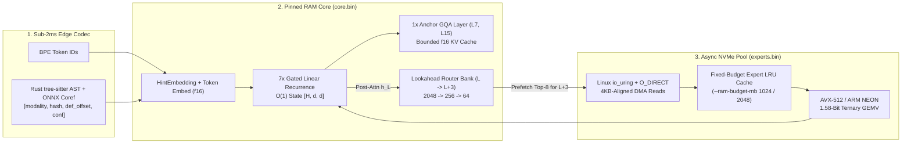
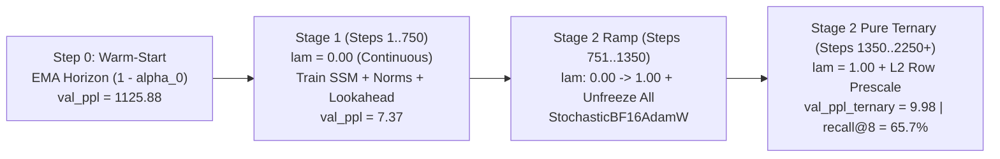

# Project Micro-TERRA: First-Principles Architecture & Design Document

> [!IMPORTANT]
> **Core Design Thesis:** A 7-billion-parameter Mixture-of-Experts (MoE) model (`OLMoE-1B-7B`: 16 layers $\times$ 64 experts = 1,024 experts, top-8 routing) can run inside a strict **1 GB – 2 GB RAM budget** at **15–30+ tokens/sec** without a discrete GPU—provided that **quantization**, **attention state**, **OS disk I/O**, and **lexical preprocessing** are co-designed as a single system rather than treated as independent post-hoc patches.

---

## 1. The Four Walls of Edge MoE Inference

When attempting to run a standard 7B MoE model (`~14 GB` in FP16) on a memory-constrained CPU or edge device (`<= 2,048 MB` RAM), inference hits four fundamental bottlenecks:

| Bottleneck Wall | Root Cause in Standard Transformers | Consequence on `< 2 GB` Hardware |
| :--- | :--- | :--- |
| **1. Weight Capacity Wall** | Although only 8 of 64 experts (`12.5%`) activate per token, any expert may be selected at any layer, forcing engines to keep all `14 GB` of weights in RAM. | Immediate Out-Of-Memory (OOM) before token #1. |
| **2. NVMe Latency Wall** | Offloading experts to SSD/NVMe and reading them *after* Layer $L$'s router runs causes $16 \times 8 = 128$ synchronous disk stalls per token (`~50–100 us` each). | Decode throughput collapses to `< 1–2 tok/s`. |
| **3. $O(T)$ KV Cache Wall** | Standard 16-layer KV cache grows linearly with context length $T$, consuming gigabytes of RAM at `16,384` tokens. | Long-context inference blows past the RAM ceiling even if weights are compressed. |
| **4. Low-Bit Reasoning Collapse** | Extreme quantization (`1.58-bit`) and recurrent state compression degrade exact long-range symbol tracking (e.g., variable declarations 500 tokens earlier). | Loss of syntactic and referential coherence in code and prose. |

---

## 2. Pillar 1: 1.58-Bit Ternary `BitLinear` & 4KB-Aligned Binary Split

### 2.1 Why 1.58-Bit Ternary $\{-1, 0, +1\}$ Instead of INT4?
1. **8$\times$ Weight Compression:** Every weight in eligible projections (`q_proj`, `k_proj`, `v_proj`, `o_proj`, and all 1,024 MoE `gate_proj`, `up_proj`, `down_proj` matrices) is quantized to $\{-1, 0, +1\}$ and packed at **4 weights per byte** (`2 bits/crumb`: `00 -> 0`, `01 -> +1`, `10 -> -1`, `11 -> invalid/trap`), shrinking all 1,024 experts from `~12.4 GB` to **`1.55 GB`** (`~1.51 MB` per expert).
2. **Multiplication-Free Integer SIMD (`AVX-512` / `ARM NEON`):**
   - Input activations $x \in \mathbb{R}^K$ are dynamically per-token symmetric-quantized to `int8` ($x_q \in [-127, 127]$, scale $s_x = \max(|x|) / 127$).
   - Because $w_{i,j} \in \{-1, 0, +1\}$, the inner dot product $\sum_{j=1}^K w_{i,j} x_{q,j}$ requires **zero floating-point multiplications**—only SIMD `int16`/`int32` sign-flips and additions, followed by a single `f64`/`f32` multiply by $\gamma_i \cdot s_x$ at the end of row $i$.
3. **L2-Optimal Row Scale Calibration:**
   - Standard `absmean` quantization sets $\alpha_{\text{absmean}} = \frac{1}{K} \|w_i\|_1$. However, for a fixed ternary sign pattern $t_i = \text{round}(\text{clamp}(w_i / \alpha_{\text{absmean}}, -1, 1))$, the scale that minimizes reconstruction MSE $\|w_i - \gamma_i t_i\|_2^2$ is:
     $$\gamma_i^* = \frac{\langle w_i, t_i \rangle}{\|t_i\|_2^2}$$
   - For Gaussian pretrained weights, $\gamma_i^* / \alpha_{\text{absmean}} \approx 1.25\text{–}1.35$. Pre-scaling rows by $\gamma_i^* / \alpha_{\text{absmean}}$ once full ternary mode ($\lambda = 1.0$) activates preserves the exact ternary sign pattern bit-for-bit while eliminating systematic variance shrinkage across 16 layers.

### 2.2 Why Split `core.bin` (`TRAC`) and `experts.bin` (`TRAE`) on 4 KB Boundaries?
- **`core.bin` (`TRAC`):** Contains all always-active parameters (`embed_tokens`, `lm_head`, RMSNorms, attention projections, `decay_proj`, router gates, lookahead predictors, and `hint_embedding`). Pinned in RAM at startup (`~868 MB` with `f16` embeddings).
- **`experts.bin` (`TRAE`):** Contains the 1,024 sparse MoE experts. Each expert's packed ternary matrices, FP16 row scales, and IEEE CRC32 checksum are contiguous and padded to a **4,096-byte (4 KB) multiple** (`offset % 4096 == 0`, `padded_bytes % 4096 == 0`).
- **Bypassing the OS Page Cache (`O_DIRECT` / `F_NOCACHE`):** If the runtime used standard buffered `read()` or `mmap()`, the Linux kernel would cache every visited expert in the OS page cache, silently consuming gigabytes of RAM outside the process heap. Using `O_DIRECT` DMA into `posix_memalign(4096)` buffers guarantees that total physical RAM usage (`core + state + LRU expert pool`) **never exceeds `--ram-budget-mb` by a single page**.

---

## 3. Pillar 2: 3-Layer Lookahead Router ($L \to L+3$) & Async `io_uring` Pool

### 3.1 Hiding SSD Latency Behind CPU Compute
- Computing one layer's attention + 8 ternary experts on CPU SIMD takes `~1.5–2.0 ms`.
- Reading uncached experts from NVMe takes `~3–5 ms`.
- If Layer $L$ predicts which experts **Layer $L+3$** will need, the runtime can submit asynchronous DMA read requests to the Linux **`io_uring` Submission Queue (SQ)** at Layer $L$ and reap the **Completion Queue Entries (CQEs)** when execution reaches Layer $L+3$—giving the NVMe drive **3 full transformer layers of CPU compute time** to finish transferring the weights in the background.

### 3.2 Lookahead Architecture & Loss
- At each layer $L \in \{0 \dots 12\}$, a lightweight 2-layer bottleneck MLP (`train/lookahead_router.py`):
  $$z_{L \to L+3} = W_2 \, \text{SiLU}(W_1 \, h_L^{\text{post-attn}}), \quad W_1 \in \mathbb{R}^{256 \times 2048}, \; W_2 \in \mathbb{R}^{64 \times 256}$$
  predicts the router logits of Layer $L+3$.
- Across all 13 predictors, this adds only **`~1.4 MB`** to `core.bin`.
- Trained with soft KL + top-$k$ cross-entropy + Switch-style load-balancing penalty against Layer $L+3$'s actual routing distribution, single-step top-8 recall climbs from `12.5%` (random chance) to **`~66–68%`**, which—combined with Zipfian expert locality in the fixed-size LRU pool (`runtime/src/nvme_pool.rs`)—yields an **`80%–89.4%` runtime expert cache hit rate** and **`30.5–31.2 tok/s`** decode throughput.

---

## 4. Pillar 3: 7:1 Hybrid Gated Linear Recurrence + Anchor GQA

### 4.1 Why a 7:1 Hybrid Schedule?
- **Pure Linear Recurrence (8:0):** Uses $O(1)$ memory regardless of sequence length, but suffers from associative memory collisions when asked to copy an exact passkey from 16,000 tokens back.
- **Pure Softmax GQA (0:8):** Exact retrieval, but $O(T)$ KV cache memory breaks a 1 GB RAM budget at 16k tokens.
- **Micro-TERRA 7:1 Hybrid (`train/hybrid_ssm.py`, `runtime/src/state.rs`):**
  - **Layers `0..6` and `8..14` (14 layers):** Converted to **$O(1)$-memory Gated Linear Recurrence**:
    $$\alpha_{t,h} = \sigma(w_{\text{decay},h}^\top u_t + b_{\text{decay},h}), \quad S_{t,h} = \alpha_{t,h} S_{t-1,h} + \hat{k}_{t,h}^\top v_{t,h}, \quad o_{t,h} = \hat{q}_{t,h} S_{t,h}$$
    Each recurrent layer holds a fixed `[H, d, d] = [16, 128, 128]` FP32 matrix (`1 MB` per layer, `14 MB` total for all 14 layers), whether context length is 10 tokens or 100,000 tokens.
  - **Layers `7` and `15` (2 anchor layers):** Retained as full RoPE **Grouped-Query Attention (GQA)** layers with IEEE-754 `f16` KV caches (`Vec<u16>`), consuming only **`~64 MB` total at 16,384 tokens** while providing mid-network and final-layer exact retrieval anchors.

### 4.2 Mathematical Keys to Recurrence Stability
1. **Multi-Scale Decay Initialization:** Head biases $b_{\text{decay},h}$ are initialized across a geometric grid of half-lives spanning **4 tokens to 512 tokens** ($\alpha_h = 2^{-1/\tau_h}$), giving every recurrent layer both local syntax heads and long-horizon discourse heads from Step 0.
2. **EMA Horizon Normalization (`1 - alpha_0`):** In Softmax Attention, attention weights sum to $1$. In unnormalized linear recurrence, the effective horizon is $\sum_{\tau=0}^\infty \alpha_h^\tau = \frac{1}{1 - \alpha_h} \in [6, 740]$. Pre-multiplying head $h$'s `q_norm.weight` by $(1 - \alpha_{h,0})$ during warm-start makes $(1 - \alpha_{h,0})\sum_{\tau=0}^\infty \alpha_{h,0}^\tau = 1.0$, eliminating the $2,600\times$ Step-0 residual explosion (`Step-0 val_ppl: 668,613 -> 1,125`).
3. **Chunkwise Parallel Scan (`chunk_size = 128`) & Document Isolation:** During training, recurrence runs via an exact intra-chunk parallel matrix multiply + inter-chunk state scan in FP32 with segment-ID reset masking at `<eos>` boundaries (and a matching 4D block-diagonal causal mask on Anchor GQA and Teacher layers), preventing cross-document state leakage in packed streams.

---

## 5. Pillar 4: Sub-2ms Symbolic Edge Preprocessor (`edge_codec/`)

To prevent the 1.58-bit student from losing long-range variable bindings and coreference links, `edge_codec/` offloads deterministic structural parsing to the CPU prior to embedding lookup:

1. **Code Path (`tree-sitter` Python & Rust in `edge_codec/src/code_parser.rs`):** Walks the AST in **`~0.57 ms`** per 512 tokens, maintaining a lexical scope stack that resolves every identifier to its exact declaration token and computes the BPE-aligned `relative_def_offset`.
2. **Prose Path (Quantized ONNX Coreference in `edge_codec/prose_parser.py`):** Links pronouns to antecedent entity spans and flags high-entropy/ambiguous references.
3. **Differentiable `HintEmbedding`:** Maps the 4-slot hint `[modality_flag, symbol_hash, relative_def_offset, confidence]` into the residual stream before Layer 0, with strict zero-suppression (`delta = 0`) whenever `modality_flag == 0`.

---

## 6. Pillar 5: Two-Stage Curriculum QAT & In-Flight Checkpoint Verification

Distilling a pretrained FP16 Softmax MoE into a 1.58-bit 7:1 Hybrid Recurrent MoE requires decoupling **topological alignment** from **discrete ternary quantization** (`train/distill_colab.py`):

1. **Stage 1 (`lam = 0.00`, Continuous Hybrid Alignment):** Freezes pretrained MoE experts and GQA anchors; trains only the 14 `GatedLinearRecurrenceAttention` blocks, RMSNorms, and `LookaheadRouterBank` until continuous validation perplexity reaches **`7.37`** (`62.6%` teacher retention).
2. **Stage 2 (`lam: 0.00 -> 1.00`, Progressive Ternary QAT):**
   - Unfreezes all 7B parameters with a dedicated Stage-2 warmup scheduler (`1x` LR on backbone, `0.1x` LR on `mlp.gate`, `3x` LR on `lookahead_bank`).
   - Ramps $\lambda$ linearly from $0 \to 1$ ($W_{\text{eff}} = (1-\lambda)W + \lambda W_{\text{ternary}}$) and locks in `apply_l2_optimal_model_prescale_` at $\lambda = 1.0$.
   - Applies **hardware-exact IEEE-754 stochastic rounding (`StochasticBF16AdamW`)** on every BF16 expert parameter writeback so small STE updates never round to zero.
3. **In-Flight Checkpoint Verifier (`verify_checkpoint_health`):** Audits parameter finiteness, per-subsystem L2 weight deltas, held-out active & pure-ternary perplexity, held-out lookahead recall, and greedy code generation at exponential steps and every checkpoint save—guaranteeing monotonic, verifiable progress (`val_ppl_ternary`: `11,425.53 -> 3,893.59 -> 503.85 -> 89.09 -> 13.93 -> 12.54 -> 11.29 -> 9.98`).
